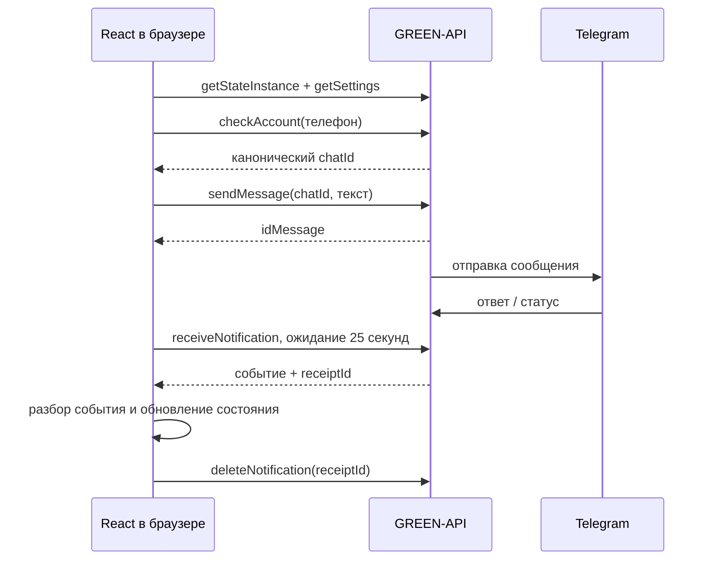

# Telegram-чат через GREEN-API

Небольшой текстовый чат на React и TypeScript. Вводишь данные своего инстанса GREEN-API, создаёшь чат по номеру телефона, отправляешь сообщение и видишь ответ из Telegram. Интерфейс по структуре похож на web.max.ru: список чатов слева, переписка справа.

В задании разрешён Telegram вместо MAX. Здесь реализован именно Telegram. Имя поддомена осталось прежним: **https://max-api.komaroff-dev.ru**.

## Что нужно для подключения

Авторизованный Telegram-инстанс в [кабинете GREEN-API](https://console.green-api.com/instanceList). Оттуда нужны `idInstance`, `apiTokenInstance` и `apiUrl`. Для нашего инстанса API-сервер — `https://4100.api.green-api.com`; адрес другого инстанса можно указать в дополнительных настройках формы.

В настройках инстанса:

| Настройка | Значение | Зачем |
|---|---|---|
| `webhookUrl` | пустая строка | Используем HTTP-очередь, без внешнего получателя webhooks |
| `incomingWebhook` | `yes` | Получать ответы собеседника |
| `outgoingWebhook` | `yes`, рекомендуется | Получать статусы отправки и доставки |
| `stateWebhook` | `yes`, рекомендуется | Узнать об изменении авторизации |

Режим отладки входящих уведомлений должен быть выключен: он подставляет отдельный webhook-адрес. Приложение проверяет настройки, но не меняет их самостоятельно. Авторизация аккаунта выполняется в кабинете провайдера; наша кнопка выхода завершает только локальную сессию.

Не открывай тот же инстанс одновременно в другом клиенте, который забирает HTTP-уведомления. Очередь у провайдера одна на весь инстанс. Между вкладками нашего сайта работает Web Lock; другой браузер и чужую интеграцию эта блокировка не контролирует.

## Как пользоваться

Короткая HTML-инструкция со скриншотами и схемами: **https://max-api.komaroff-dev.ru/guide.html**. Исходник — `public/guide.html`; Vite копирует страницу и её материалы в сборку. Ссылки из приложения открывают её в новой вкладке, чтобы не сбрасывать подключённую сессию. Скриншоты сняты с текущего интерфейса на учебных данных, без реальных контактов и ключей.

После изменения интерфейса скриншоты можно переснять командой `npm run capture:guide`. Скрипт `tests/capture-guide.mjs` запускает локальный Vite и изолированный браузер, перехватывает внешние API-запросы и сохраняет три JPEG в `public/guide/images/`. Рабочие ключи и Telegram для этого не нужны.

1. Открой сайт и введи `idInstance` и `apiTokenInstance`.
2. Нажми «Подключиться». Приложение проверит авторизацию и готовность входящей очереди.
3. Введи номер получателя с кодом страны. Пробелы, скобки, дефисы и начальный `+` допустимы. Код страны приложение не угадывает.
4. Создай чат. `CheckAccount` вернёт настоящий `chatId`; именно его используем для отправки и сопоставления ответов.
5. Напиши сообщение и отправь. Enter отправляет, Shift+Enter добавляет строку. Максимум — 4096 единиц UTF-16; эмодзи могут занимать две. Текст не обрезается.
6. Ответ из Telegram появится в переписке через очередь уведомлений. Переключение чатов не останавливает приём.

«Принято» означает, что API вернул ID сообщения. Это ещё не подтверждение доставки. Если провайдер прислал статус доставки или прочтения, он появится рядом с сообщением.

Если соединение оборвалось во время отправки, результат может быть неизвестен. Автоматического повторения здесь нет: иначе можно отправить один текст дважды. При ошибке подтверждения входящего уведомления приём приостанавливается; кнопка повтора заново проверяет очередь.

## Где что находится

| Код | Что делает |
|---|---|
| `src/api/greenApi.ts` | Проверяет адрес и ключи, вызывает методы GREEN-API, разбирает ответы и выдаёт безопасные ошибки |
| `src/api/notifications.ts` | Разбирает обычный и расширенный текст, статусы сообщений и события авторизации |
| `src/state/pollNotifications.ts` | Последовательный приём, подтверждение, задержки повторов и блокировка очереди между вкладками |
| `src/state/chatState.ts` | Чаты, сообщения, черновики, дедупликация и сопоставление статусов |
| `src/phone.ts` | Проверка и нормализация телефона |
| `src/types.ts` | Небольшие общие типы данных |
| `src/hooks/useChatSession.ts` | Подключение, один цикл очереди, создание чата и отправка; отмена запросов при выходе |
| `src/components/ConnectionForm.tsx` | Форма подключения с закрытым полем ключа и настройкой API-адреса |
| `src/components/ChatSidebar.tsx` | Список чатов, телефон нового собеседника, состояние приёма и выход |
| `src/components/ChatWindow.tsx` | Заголовок переписки и связка списка сообщений с полем ввода |
| `src/components/MessageList.tsx` | Сообщения, даты, статусы и прокрутка только для читающего снизу |
| `src/components/MessageComposer.tsx` | Черновик, Enter / Shift+Enter, ограничение длины и блокировка повторной отправки |
| `src/App.tsx`, `src/styles.css` | Выбор экрана и мобильное переключение списка / переписки, оформление |
| `tests/` | Тестовая конфигурация и браузерные сценарии; вымышленные ответы API находятся только в тестах |
| `deploy/` | Отдельный Nginx host, HTTPS и переключение статических релизов |

Компоненты отвечают за отображение и действия пользователя. API-клиент отвечает за HTTP. Чистый reducer меняет состояние чатов. Один цикл приёма обслуживает всю очередь, а не только открытый чат.



Повторно полученное сообщение не добавляется в переписку второй раз, но его уведомление подтверждается. Корректные события неподдерживаемого типа пропускаются и подтверждаются, чтобы очередь не застревала. Повреждённое текстовое событие не удаляется: приём останавливается с ошибкой.

## Хранение и ограничения

- Ключ, переписка и черновики существуют только в памяти вкладки. `localStorage`, IndexedDB и cookie для них не используются.
- После перезагрузки или выхода локальная переписка исчезает. Уже подтверждённые уведомления заново из очереди не получить.
- VPS раздаёт HTML, JavaScript и CSS. Запросы с ключом идут непосредственно в GREEN-API; наш сервер переписку не получает.
- GREEN-API включает токен в адрес метода. Он будет виден владельцу вкладки в её DevTools; приложение не пишет такие адреса в ошибки и отчёты.
- Получение работает, пока открыт браузер. Это не серверный клиент с постоянной историей. Провайдер хранит уведомления очереди 24 часа.
- Только текстовые сообщения. Вложения, звонки, загрузка старой истории, регистрация и смена настроек инстанса не реализованы.
- Нужен браузер с Web Locks и HTTPS; для локальной разработки подходит `localhost`.
- Бесплатный Telegram Developer ограничен тремя чатами и 100 проверками номера в месяц. `exist: false` также может означать, что номер скрыт настройками приватности.

## Локальный запуск и проверки

Отдельная пошаговая страница: **https://max-api.komaroff-dev.ru/local-run.html**. Там же ZIP с исходниками, распаковка, команды для Windows и macOS/Linux, остановка и подсказки при ошибках. Исходник страницы — `public/local-run.html`.

Запуск проверен на Node.js 22.22.2 и npm 10.9.7. Для повторения используй Node.js 22.x не ниже 22.12. Зависимости закреплены `package-lock.json`.

```sh
npm ci
npm run dev -- --host 127.0.0.1 --port 5173 --strictPort
```

На Windows в PowerShell можно использовать `npm.cmd` вместо `npm`. Открой **http://127.0.0.1:5173/**, терминал оставь работающим. Остановка — Ctrl+C. Ключи вводятся в форме, файл `.env` не нужен.

Архив `/downloads/telegram-chat-source.zip` добавляется в готовый релиз после сборки: `git archive --format=zip --prefix=telegram-chat/ HEAD`, только отслеживаемые исходники. В нём нет `.git`, зависимостей, ключей, переписки и приватных отчётов. ZIP не хранится внутри репозитория.

```sh
npm run typecheck
npm run lint
npm test
npm run test:e2e
npm run build
```

Браузер для e2e при первом запуске устанавливается через `npx playwright install chromium`. Тесты не отправляют настоящие сообщения и не используют рабочие ключи. Настоящий обмен проверяется отдельно через опубликованный сайт и согласованного получателя. Рабочие ключи не добавляются в `.env`, исходники или тестовые фикстуры.

## Развёртывание

Сборка выполняется локально. На VPS попадает только содержимое `dist`, включая отдельный `release.json` с версией. Каталог релизов — `/srv/portfolio/max-api/releases/`; Nginx смотрит на `/srv/portfolio/max-api/current`.

Для первого запуска используется `deploy/nginx.http.conf`: он обслуживает только проверку домена Let's Encrypt. После выпуска сертификата устанавливается `deploy/nginx.conf`. Перед reload выполняется `nginx -t`.

`deploy/renew-certificate.sh` установлен как hook Certbot: после обновления сертификата нашего домена он проверяет конфигурацию и перечитывает Nginx. Для остальных доменов этот hook ничего не делает.

Новый релиз проверяется по SHA-256, распаковывается в новый каталог и подключается атомарной заменой symlink `current`. Предыдущий каталог сохраняется; откат меняет symlink обратно. HTML не кешируется, файлы с хешем в имени кешируются. Nginx разрешает браузеру внешние подключения только к API-серверам GREEN-API.

```sh
# На VPS, после загрузки архива. SHA256 и RELEASE_ID берём из локального отчёта сборки.
bash /tmp/max-api-activate-release.sh /tmp/max-api-RELEASE_ID.tar.gz SHA256 RELEASE_ID
```

Если предыдущий релиз есть, откат можно сделать без перезапуска приложений: переключить `current.next` на каталог из `previous`, затем `mv -Tf current.next current`. Здесь нет backend-процесса или схемы БД для отката. При первом выпуске предыдущего рабочего релиза ещё нет.

## Документация провайдера

- [Формат запросов Telegram](https://green-api.com/telegram/docs/request-format/)
- [CheckAccount](https://green-api.com/telegram/docs/api/service/CheckAccount/)
- [SendMessage](https://green-api.com/telegram/docs/api/sending/SendMessage/)
- [HTTP-очередь](https://green-api.com/telegram/docs/api/receiving/technology-http-api/)
- [ReceiveNotification](https://green-api.com/telegram/docs/api/receiving/technology-http-api/ReceiveNotification/)
- [DeleteNotification](https://green-api.com/telegram/docs/api/receiving/technology-http-api/DeleteNotification/)
- [Статусы сообщений](https://green-api.com/telegram/docs/api/receiving/notifications-format/statuses/OutgoingMessageStatus/)
- [Тариф Telegram Developer](https://green-api.com/telegram/docs/about-tariffs/)
